# claude-handoff

[](https://www.npmjs.com/package/@neoacar/claude-handoff)
[](./LICENSE)
[](https://nodejs.org/)

Make Claude Code session context portable between machines via git.

Claude Code keeps every conversation in `~/.claude/projects/` on your
local machine — full transcripts, decisions, tool calls, accumulated
memory. Nothing syncs to the repo. Nothing travels with `git push`.
When a teammate picks up the branch, they get the code but none of
the reasoning.

**claude-handoff** packages that context into `./.claude-shared/` on
export, scrubs local absolute paths and secrets, and reconstructs it
into the teammate's `~/.claude/projects/` on import. `claude --resume`
then shows the shared session with its original title and full
history intact.

<p align="center">
  
</p>

## Install

```bash
npm install -g @neoacar/claude-handoff
```

Then run `claude-handoff` from any project directory.

## The flow

```bash
# Alice's machine, in the project
claude-handoff export                 # lists her sessions, writes nothing
claude-handoff export "upload"        # export the one whose title mentions "upload"
git add .claude-shared/ && git commit -m "handoff" && git push

# Neo's machine
git pull
claude-handoff import                 # reconstruct sessions under ~/.claude/projects/
claude --resume                       # pick Alice's session, keep going
```

There is no setup step. Alice's session shows up in Neo's `/resume`
picker with its original title and 100% of the conversation history,
tool calls, and subagent transcripts.

**No shared repo?** Send one file instead:

```bash
# sender
claude-handoff export "upload" -o fix-upload.handoff.tgz
# ...send the file any way you like...

# receiver, in their checkout of the project
claude-handoff import fix-upload.handoff.tgz
```

The archive holds the same redacted bundle and is checksummed, so a
damaged or half-downloaded file is refused instead of half-imported.

<p align="center">
  
</p>

**Iteration.** The same session can ping-pong through the repo
multiple times. After Neo resumes and keeps working, Neo runs
`export` again and Alice imports the follow-up. Each round's
author and timestamp is preserved in the manifest, so you can see
who added what. Concurrent editing (both sides resuming at once
and both appending) is **not** yet supported — use the tool for
sequential handoff.

## What ships across machines

Every session is exported as a bundle directory:

```
.claude-shared/sessions/<sessionId>/
  main.jsonl              # the transcript (streamed, path-rewritten, redacted)
  metadata.json           # author, timestamps, title
  subagents/*.jsonl       # Explore / Plan / general-purpose agent transcripts
  subagents/*.meta.json   # subagent metadata (agent type, description)
  session-memory/*.md     # session-scoped memory, when present
  tool-results/*          # large tool outputs the transcript points at by path
```

Plus optional project-level auto-memory (`--memory` flag) under
`.claude-shared/memory/`. And a `.manifest.json` tying it all together.

On import, the layout is reconstructed exactly as Claude Code expects
it, with every absolute path rewritten from the sender's filesystem
to the receiver's.

## Commands

| Command                           | What it does                                                          |
| --------------------------------- | --------------------------------------------------------------------- |
| `claude-handoff export [session]` | Export sessions; with nothing chosen, list them and write nothing     |
| `claude-handoff import [file]`    | Import from `.claude-shared/`, or from an archive file                |
| `claude-handoff status`           | Local vs shared sessions and what is not exported yet (`-v` for more) |
| `claude-handoff doctor`           | Check the setup: sessions, Claude Code version, bundles, redaction    |
| `claude-handoff skill install`    | Let Claude Code run handoffs when you ask it to                       |

Running `claude-handoff` alone shows `status`.

### Choosing what to export

```
claude-handoff export "fix upload"   words from the title, or an ID prefix
claude-handoff export -n 1           the most recent session (-n 3 for three)
claude-handoff export --all          every session of this project
```

Add `-o <file>` to write one archive file instead of `.claude-shared/`,
`--memory` to include the project's auto-memory files (`MEMORY.md`
excluded; Claude Code regenerates it), and `--dry-run` to preview.

### Import

`claude-handoff import` reads `.claude-shared/`; `claude-handoff import
<file>` reads an archive. `--dry-run` previews.

When the shared bundle is **ahead** of your local copy (teammate
shared newer work), `import` catches you up on its own. When your
local copy has **unshared** work (you resumed after the last import),
`import` skips it and says so; `--overwrite` discards the local
changes and takes the bundle. Pass it only when you mean to.

### Less common export options

```
--since <date>       only sessions started on or after an ISO date
--author <name>      name recorded in the bundle (default: git user.name)
--strip-progress     drop streaming progress records to shrink the bundle
--keep-signatures    keep signed thinking blocks (default: strip them, to
                     avoid API 400s after resuming under another API key)
--force              export even if the shared bundle looks newer than
                     your local copy
--no-env-scan        do not scrub values found in .env files and
                     secret-named environment variables
--no-redact          turn redaction off; needs --i-know-what-im-doing too
```

### Custom redaction patterns

Create `.claude-handoff-ignore` at the project root with one regex
per line (`#` for comments). Each pattern is applied on top of the
built-in ones, with matches replaced by `[REDACTED:custom-N]`. Check
it in so the whole team shares the same scrub rules.

### Letting Claude Code do it

`claude-handoff skill install` writes a skill to
`~/.claude/skills/claude-handoff/`. After that you can say "hand this
session off to a teammate" in Claude Code and the agent previews,
exports and reports the redactions. It never commits, pushes, or turns
redaction off; those stay with you. `claude-handoff skill print` shows
the file without installing it.

## How it handles the tricky parts

- **Path rewriting.** Absolute paths like `/home/alice/myapp/file.ts`
  become portable placeholders (`{{PROJECT_ROOT}}/file.ts`) on export,
  translate back to the receiver's paths on import. Path-component
  boundary-aware: a project named `auth` never accidentally rewrites
  the word `auth` inside source code.
- **Claude store keys.** Memory files and in-transcript references to
  `~/.claude/projects/<key>/...` go through a `{{CLAUDE_STORE}}`
  placeholder so they land at the receiver's key, not the sender's.
- **Secret redaction.** 15 built-in patterns (AWS, GitHub classic and
  fine-grained, Anthropic, OpenAI including `sk-proj-`, Google, Slack
  tokens and webhooks, bearer tokens, password and `api_key` /
  `secret` / `token` assignments, passwords in `https://` and
  `postgres://`-style URLs, PEM blocks) replace matches with
  `[REDACTED:type]`. Overlapping matches are merged into one
  redaction, so a key is never left half-removed. Export reports both
  the count of unique secrets found and the total markers written; a
  redaction log lives at `.claude-handoff/redaction-log.json`
  (gitignored) for review.
- **Your project's own secrets.** Patterns only know shapes; a
  database password has none. Export reads the project's `.env` files
  (not `.env.example` and friends) and secret-named environment
  variables, and removes those exact values wherever they appear,
  marked `[REDACTED:env:DB_PASSWORD]`. It knows the value as written,
  JSON-escaped and URL-encoded; other encodings (base64, for one) are
  not recognised. Values that are short, numeric,
  or look like ordinary settings (`development`, a port, a path) are
  left alone. `--no-env-scan` turns this off.
- **Account identity scrubbing.** Recent Claude Code versions record
  the signed-in account's email and organization UUID inside the
  transcript. Export learns both from the session and scrubs them
  everywhere in the bundle (`[REDACTED:account-email]`, a nil UUID),
  reported as `account-email` / `account-org` in the redaction log.
  Bundles written by 0.2.0 or earlier still contain them; running
  `export` with a current version rewrites those bundles automatically. Anything
  already committed stays in git history.
- **Project store resolution.** Not a naive slug match — canonicalizes
  the project root (`realpath` + Unicode NFC) and, if the computed key
  misses, falls back to reading `cwd` fields from candidate session
  files until it finds the right one. Survives symlinks, macOS vs
  Linux Unicode differences, and Claude Code slug-rule changes.
- **Malformed JSONL recovery.** Real sessions occasionally contain
  concatenated records or truncated lines. The parser tries `}{`
  split recovery, warns on failure, and keeps going instead of
  crashing.
- **`thinking.signature` stripping.** Thinking-block signatures are
  API-key + model bound. Resume doesn't validate them but the next
  API turn can 400 on mismatch. Export strips them by default; pass
  `--keep-signatures` when you know the receiver shares your key/model.

## Safety

- **Redact by default.** `--no-redact` requires a second
  `--i-know-what-im-doing` flag. No way to turn off redaction by
  accident.
- **No auto-commit.** The tool writes files; you run `git add` and
  `git commit` yourself. Always review `git diff .claude-shared/`
  before pushing.
- **Never changes your source.** It reads `~/.claude/` and, for
  redaction, the project's `.env` files; `.env` values are used in
  memory only and are never written anywhere. It writes to
  `.claude-shared/`, `.claude-handoff/` (local log), the receiver's
  `~/.claude/`, and an archive file only where you name one.
- **Redaction is a safety rail, not a guarantee.** Patterns can't catch
  every secret shape, and the `.env` scan only knows the values on the
  exporting machine. Use `.claude-handoff-ignore` for project-specific
  patterns. Always diff before committing, and send an archive only to
  people you would show the conversation to.

## Known limitations

- **`MEMORY.md` is not bundled.** Claude Code regenerates it from the
  sibling memory files via `/dream` consolidation; shipping a stale
  one would stamp over the receiver's. Individual memory files are
  bundled with `--memory`.
- **Windows untested.** Slug computation and path rewriting have
  only been validated on Linux. macOS should work (same POSIX paths
  - realpath + NFC handling). Windows likely needs work.
- **Large sessions.** Some sessions are 2 MB+. Consider
  `.gitattributes` with git-lfs on projects with many sessions.
- **Session forking.** If Alice exports, Neo imports, Neo continues,
  Neo exports — the merge story is "skip or overwrite" right now.
  Proper fork/merge is future work.

## Development

```bash
git clone https://github.com/NeoAcar/claude-handoff
cd claude-handoff
npm install
npm run build
npm test               # vitest, ~230 tests
npm run lint           # prettier --check + tsc --noEmit
npm link               # optional: make `claude-handoff` available globally
```

## How this relates to Remote Control

Claude Code now ships [Remote Control](https://code.claude.com/docs/en/remote-control)
(`/remote-control`), which the maintainers point to in the cross-device
threads below. It lets you watch and steer a session that is still
running in a terminal from the browser or phone. The session keeps
living on the original machine.

claude-handoff covers the other case: the transcript itself moves, so
a teammate (or you, on another machine) can `/resume` it there with the
original machine switched off. Last verified end-to-end (export →
import → `claude --resume`) against Claude Code 2.1.289.
`claude-handoff doctor` tells you if your Claude Code is newer than that.

## Related discussions

- [anthropics/claude-code#11455](https://github.com/anthropics/claude-code/issues/11455) — Session Handoff / Continuity Support (open, most active)
- [anthropics/claude-code#44063](https://github.com/anthropics/claude-code/issues/44063) — Resume Any Claude Session in the CLI (closed by its author)
- [anthropics/claude-code#31992](https://github.com/anthropics/claude-code/issues/31992) — Cross-machine session resume for CLI-to-CLI handoff (open)
- [anthropics/claude-code#47926](https://github.com/anthropics/claude-code/issues/47926) — Allow resuming Claude Code sessions across devices (closed, answered with Remote Control)
- [anthropics/claude-code#10368](https://github.com/anthropics/claude-code/issues/10368) — Chat Package Export/Import: Git-compatible format for team collaboration (the original request, closed/locked)

## License

MIT — see [LICENSE](./LICENSE).
